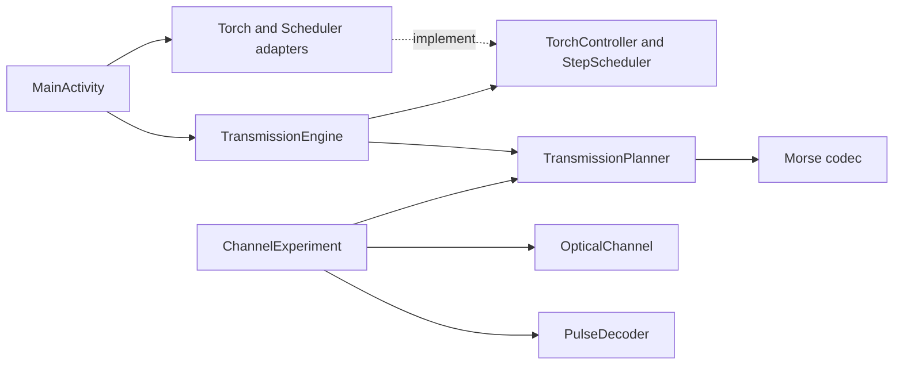

# Architecture

## Goals

- Keep signal logic pure, deterministic, and testable on a plain JVM.
- Keep Android code as thin adapters.
- Make every experiment reproducible from a seed.

## Module Structure

This project is a client-only Android app. It has no server, so no `frontend/` and `backend/` split applies.

```text
android-app/
├── core/src/main/kotlin/com/juanmafx/opticalhud/core/
│   ├── morse/          MorseAlphabet, MorseEncoder, MorseDecoder, MorseMessage
│   ├── timing/         MorseTiming, FlashStep, TransmissionPlanner
│   ├── transmission/   TransmissionEngine and its TorchController and StepScheduler ports
│   ├── channel/        SeededRandom, OpticalChannel, Pulse
│   ├── decoder/        UnitEstimator, PulseDecoder
│   └── analysis/       Statistics, ChannelExperiment, ChannelExperimentCli
└── app/src/main/java/com/juanmafx/opticalhud/
    ├── app/                  MainActivity
    ├── data/torch/           AndroidTorchController
    ├── data/scheduler/       HandlerStepScheduler
    └── features/transmitter/ MorseHighlighter
```

## Dependency Rule



`app` depends on `core`. `core` has no dependency on Android, so a domain class that imports an Android API fails to compile.

## Transmission Flow

1. `MorseEncoder` normalizes text into words and counts skipped characters.
2. `TransmissionPlanner` converts the message into alternating lit and dark `FlashStep` values, each mapped to its position in the rendered Morse string.
3. `TransmissionEngine` schedules each step only after the previous step has run, delayed by that step's full duration. A stalled UI thread can stretch the timing but cannot release queued flashes in a burst. The trade-off is that scheduling latency accumulates into the total transmission time.
4. A torch failure cancels pending steps, turns the torch off, and notifies the listener.

## Signal Model

One Morse unit `u` defines all ITU durations:

| Element | Duration |
| --- | ---: |
| Dot | 1u |
| Dash | 3u |
| Gap between symbols | 1u |
| Gap between letters | 3u |
| Gap between words | 7u |

Speed follows the PARIS convention: `WPM = 1200 / u`, with `u` in milliseconds. The default 200 ms unit is 6 WPM.

**Flash safety.** Consecutive light onsets are at least `2u` apart. The 170 ms minimum gives a 340 ms spacing, which keeps any one-second window at or below three onsets. Property tests check this for the plan and for the engine under a simulated scheduler stall. The guarantee covers commanded onsets: torch hardware latency is not measured.

## Algorithms and Complexity

For `n` input characters, `s` Morse symbols, and `p` pulses. Each character contributes at most 5 symbols, so `s` and `p` are `O(n)`.

| Operation | Method | Time | Space |
| --- | --- | --- | --- |
| Encode | Hash lookup per character | `O(n)` | `O(n)` |
| Character lookup | Dichotomic tree in a heap-indexed array | `O(L)`, `L <= 5` | `O(2^L)` |
| Plan | Single pass with a cursor | `O(s)` | `O(s)` |
| Estimate unit | Optimal 1-D two-cluster split using prefix sums | `O(p log p)` | `O(p)` |
| Decode pulses | Threshold classification | `O(p log p)` including estimation | `O(p)` |
| Edit distance | Levenshtein with two rows | `O(ab)` | `O(min(a, b))` |
| Wilson interval | Closed form | `O(1)` | `O(1)` |
| Experiment | `J` jitter levels, `T` trials, message length `m` | `O(J T m log m)` for decoding plus `O(J T m^2)` for edit distance | `O(m)` per trial |

### Blind Unit Estimation

Lit durations are sorted. A sweep over split points maximizes `S1^2/k + S2^2/(n-k)`, which is equivalent to minimizing within-cluster squared error for two clusters. If the ratio of cluster means falls outside `[2.0, 4.5]`, the message probably contains only one symbol class and the decoder falls back to the nominal unit. Otherwise the unit is the least-squares fit of durations to weights 1 and 3:

```text
u = (sum(dots) + 3 * sum(dashes)) / (dotCount + 9 * dashCount)
```

Classification boundaries are the midpoints between adjacent ideal durations: `2u` for lit pulses, then `2u` and `5u` for gaps.

## Reproducibility

`SeededRandom` implements SplitMix64 and is checked against a known output vector. Gaussian samples use the Box-Muller transform with `StrictMath`, whose results the Java specification defines exactly, so a seed defines the same stream on every conforming JVM. Each experiment point receives its own stream derived from the root seed.

## Statistical Method

- Message success is a binomial proportion reported with a 95% Wilson interval. Trials are independent, so the interval is appropriate.
- Character error rate is Levenshtein distance divided by reference length. It is a point estimate with no interval, because errors within one message are correlated.

## Model Limitations

The channel applies independent Gaussian jitter and frame quantization. It does not model ambient light, motion, rolling shutter, torch rise and fall time, dropped frames, or clock drift. Results describe this model and should not be read as real-world range or reliability.

## Recommended Next Steps

1. Add a CameraX receiver that produces `Pulse` values for the existing decoder.
2. Validate the channel model against recorded torch captures.
3. Add framing with a preamble and checksum before moving to a binary protocol.
4. Add authenticated encryption before any sensitive use.

## References

- G. L. Steele, D. Lea, and C. H. Flood. "Fast Splittable Pseudorandom Number Generators." OOPSLA, 2014.
- G. E. P. Box and M. E. Muller. "A Note on the Generation of Random Normal Deviates." Annals of Mathematical Statistics, 1958.
- E. B. Wilson. "Probable Inference, the Law of Succession, and Statistical Inference." JASA, 1927.
- V. I. Levenshtein. "Binary Codes Capable of Correcting Deletions, Insertions, and Reversals." Soviet Physics Doklady, 1966.
- ITU-R Recommendation M.1677-1, International Morse Code.
- W3C WCAG 2.2, Success Criterion 2.3.1, Three Flashes or Below Threshold.
